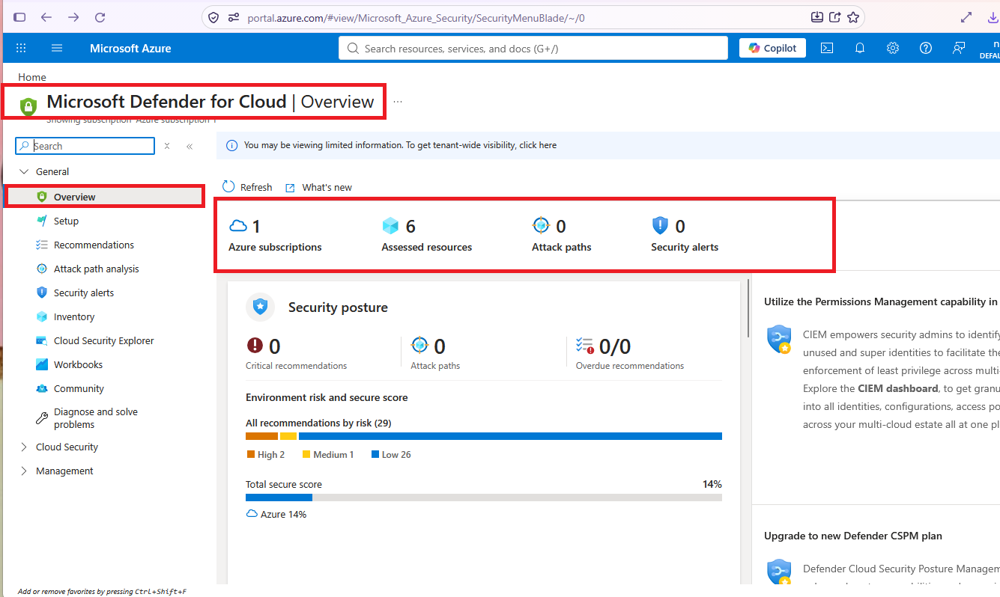
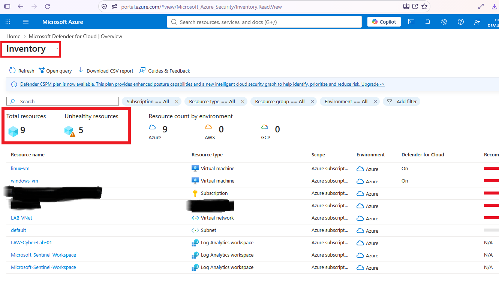
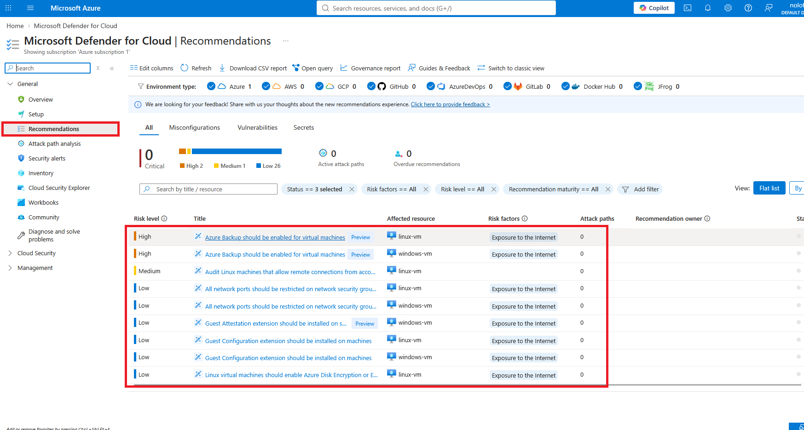
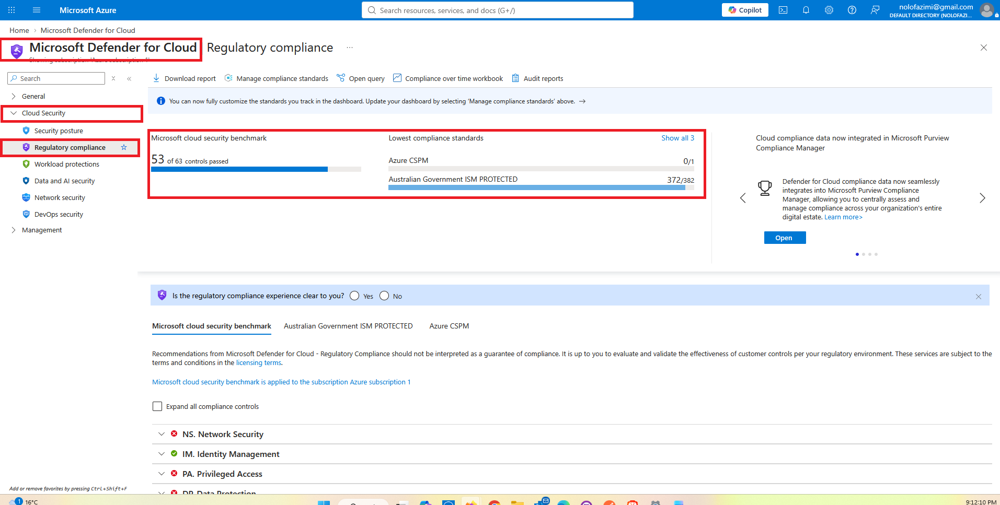
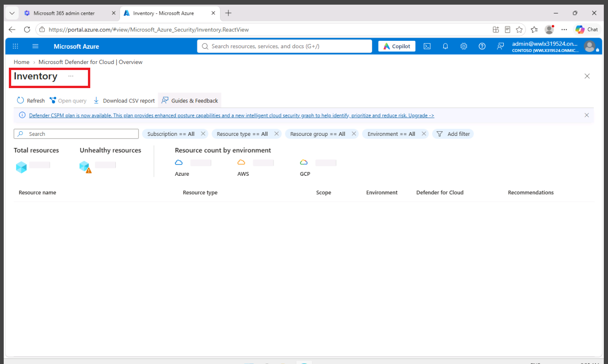

# Microsoft Defender for Cloud — Security Posture Assessment

## Project Overview

This project documents a hands-on Microsoft Defender
for Cloud lab focused on Cloud Security Posture
Management (CSPM), security recommendations,
resource assessments, regulatory compliance, and
Defender plan configuration.

The lab was performed in a controlled Microsoft
training environment.

## Security Objectives

- Explore Microsoft Defender for Cloud.
- Review Azure resource security posture.
- Identify unhealthy security recommendations.
- Investigate recommended remediation actions.
- Review Microsoft Cloud Security Benchmark controls.
- Examine CSPM and Defender for Servers configurations.

## Technologies Used

- Microsoft Azure
- Microsoft Defender for Cloud
- Cloud Security Posture Management (CSPM)
- Microsoft Cloud Security Benchmark
- Azure Virtual Machines
- Microsoft Defender for Servers

## Lab Walkthrough

### 1. Security Posture Overview

Navigated to Microsoft Defender for Cloud and
examined assessed resources, recommendations,
security alerts, and security posture information.

### 2. Virtual Machine Assessment

Reviewed the Azure VM inventory and examined
the security recommendations associated with
the lab virtual machine.

### 3. Unhealthy Security Recommendations

Inspected an unhealthy recommendation to understand
the affected resource, security implications,
and suggested remediation steps.

### 4. Remediation Guidance

Reviewed Microsoft-provided remediation guidance
without applying changes to the assessed resource.

### 5. Recommendations Dashboard

Examined security recommendations and resource
health information.

### 6. Regulatory Compliance

Explored Microsoft Cloud Security Benchmark
controls, including network security and DNS
security assessments, where available.

### 7. Defender Plans

Reviewed Defender for Cloud environment settings,
including CSPM and Defender for Servers.

## Security Analysis

Microsoft Defender for Cloud helps security teams
identify misconfigurations, assess resource security
posture, prioritise remediation actions, and review
compliance with security benchmarks.

A recommendation represents a potential security
weakness that should be assessed in context before
remediation.

## Skills Demonstrated

- Cloud Security Posture Management
- Azure Resource Security Assessment
- Security Recommendation Analysis
- Microsoft Defender for Cloud
- Cloud Security Benchmark Assessment
- Remediation Planning
- Cloud Security Configuration Review

## Lab Disclaimer

This project documents hands-on experiences
in an authorised Microsoft lab tenant.

