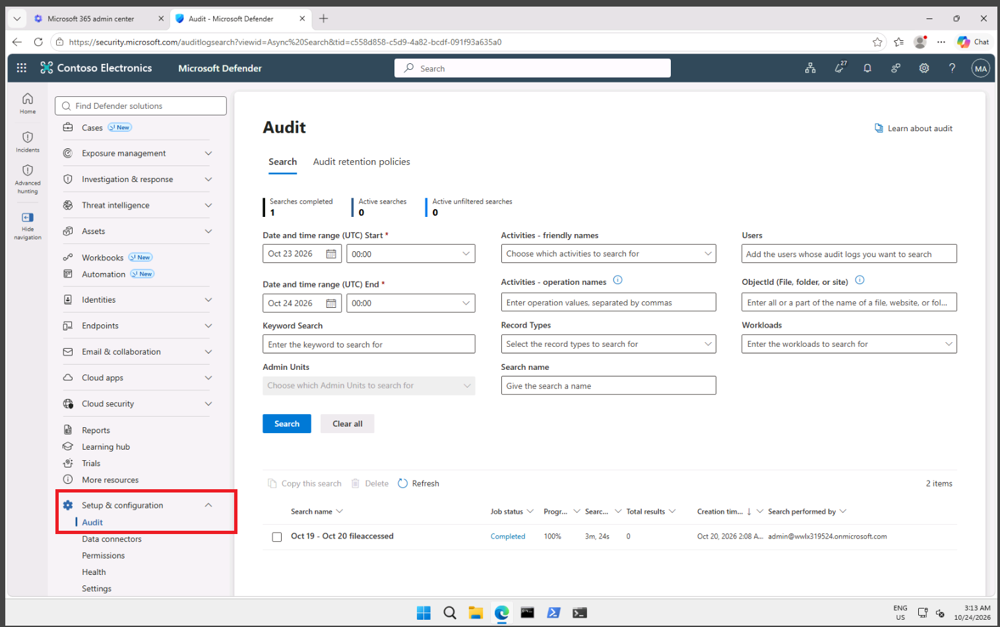
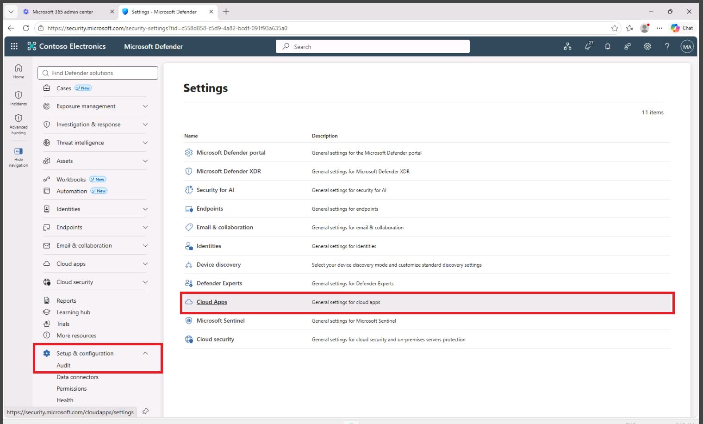
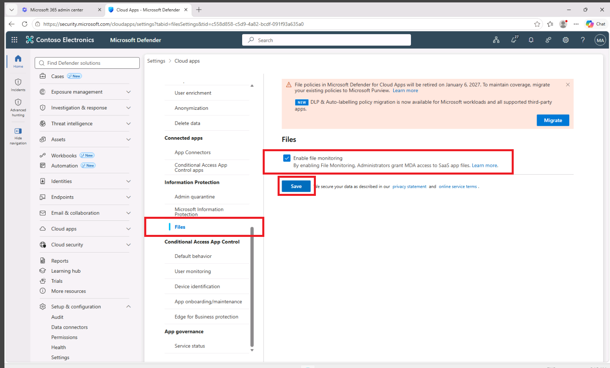

## Lab Evidence

# Microsoft 365 Audit Logging & File Monitoring Lab

### Overview

This hands-on lab focused on enabling Microsoft 365 audit logging and file monitoring to improve security visibility and support investigation of user, administrator, and file activity.

What I Configured

Enabled Microsoft 365 audit logging

Enabled recording of user and administrator activity

Accessed Microsoft Defender security settings

Configured Microsoft Defender for Cloud Apps

Enabled file monitoring

Verified the security monitoring configuration

1. Enabled Microsoft 365 Audit Logging

I accessed:

Microsoft 365 Admin Center → Security → Setup & configuration → Audit

I then enabled recording of user and administrator activity.

Audit logging helps security teams understand:

Who performed an action

What action occurred

When it occurred

Which Microsoft 365 service was involved

Screenshot

2. Accessed Cloud Apps Settings

I navigated to:

Microsoft Defender → Setup & configuration → Settings → Cloud apps

I then opened:

Information Protection → Files

Screenshot

### Microsoft Defender Audit

### Cloud Apps File Monitoring

### File Monitoring Enabled

