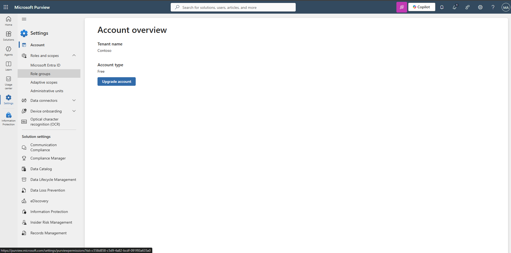
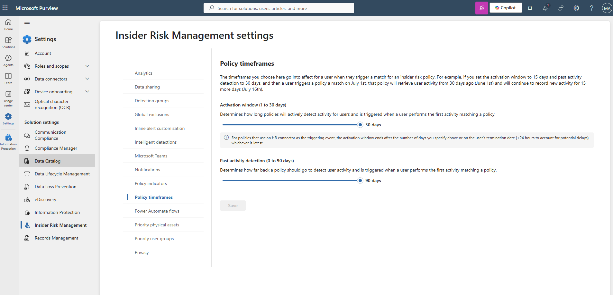
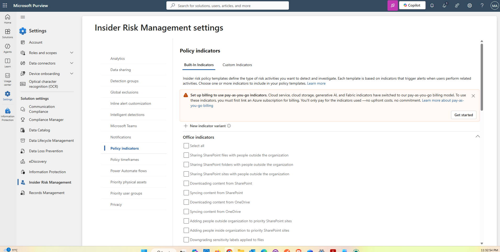
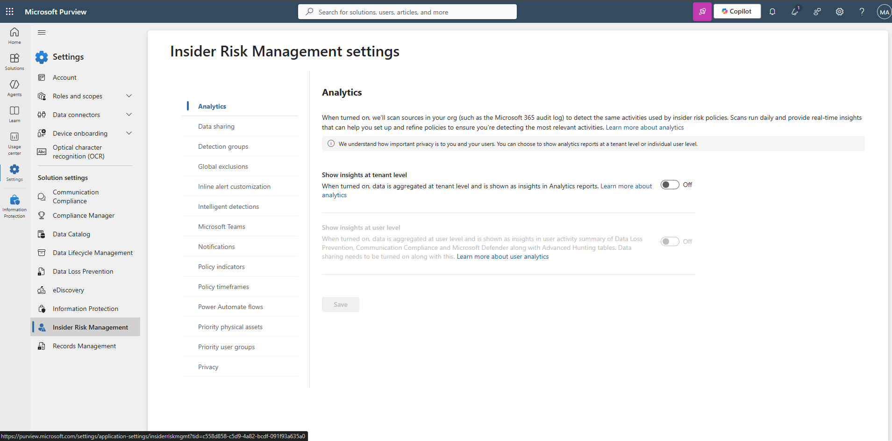
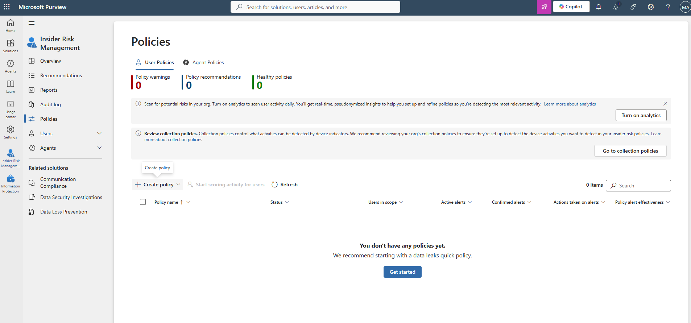
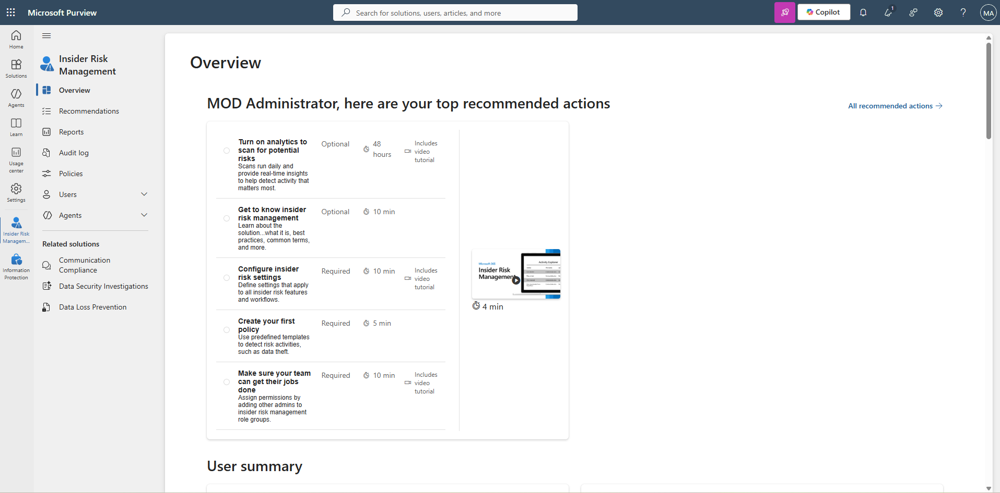
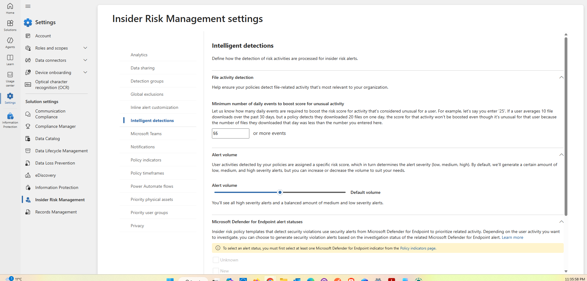
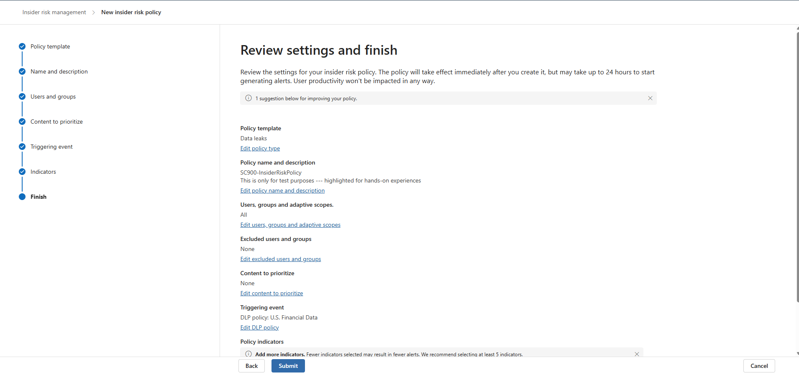
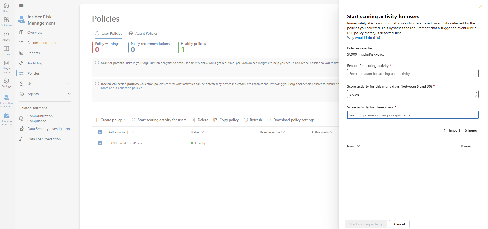

# Microsoft Purview – Insider Risk Management
## Hands-On Lab Implementation & Evidence

## Lab Overview

This lab demonstrates practical exploration of Microsoft Purview Insider Risk Management within a Microsoft 365 training environment.

The exercise focused on administrative role permissions, privacy settings, insider risk indicators, policy configuration, DLP integration, and risk-scoring concepts.

---

## Step 1 – Review Insider Risk Management Roles

### What I Did

1. Opened the Microsoft Purview portal.
2. Navigated to Settings > Roles & scopes > Role groups.
3. Searched for Insider Risk Management roles.
4. Examined the available roles and permissions.
5. Verified the existing members assigned to the Insider Risk Management role group.

### Security Knowledge Demonstrated

Understanding how role-based access controls help restrict sensitive security management capabilities to authorised personnel.

### Screenshot Evidence

---

## Step 2 – Examine Privacy Settings

### What I Did

1. Navigated to Settings > Insider Risk Management.
2. Opened Privacy settings.
3. Reviewed the options for displaying or anonymising user identities.
4. Examined how these controls support privacy during insider risk investigations.
5. Retained the default settings.

### Security Knowledge Demonstrated

Understanding how privacy controls can help balance security monitoring with employee confidentiality.

### Screenshot Evidence

---

## Step 3 – Configure Policy Indicators

### What I Did

1. Opened Policy indicators.
2. Reviewed available activity indicators.
3. Expanded Office indicators.
4. Selected all Office indicators as instructed.
5. Examined how activity indicators contribute to insider risk scoring.

### Security Knowledge Demonstrated

Understanding how user activity indicators support the identification and assessment of potential insider risks.

### Screenshot Evidence

---

## Step 4 – Review Policy Timeframes

### What I Did

1. Opened Policy timeframes.
2. Examined the activation window.
3. Reviewed past activity detection settings.
4. Studied how detection windows affect monitoring after triggering events.
5. Retained the default values.

### Security Knowledge Demonstrated

Understanding how detection periods affect the monitoring and assessment of potentially risky user activities.

### Screenshot Evidence

---

## Step 5 – Create a Custom Insider Risk Policy

### What I Did

1. Opened Solutions > Insider Risk Management.
2. Navigated to Policies.
3. Selected Create policy > Custom policy.
4. Chose the Data Leaks policy template.
5. Verified that the DLP policy prerequisite was satisfied.
6. Entered the policy name:

   SC900-InsiderRiskPolicy

7. Reviewed user and group targeting options.

### Security Knowledge Demonstrated

Practical familiarity with creating an insider risk policy and verifying prerequisites for data-leak detection.

### Screenshot Evidence

---

## Step 6 – Configure DLP Triggering Events

### What I Did

1. Opened the Triggers configuration.
2. Selected User matches a data loss prevention (DLP) policy.
3. Selected the existing U.S. Financial Data policy.
4. Reviewed how a DLP match can trigger insider risk monitoring.

### Security Knowledge Demonstrated

Understanding the integration between Data Loss Prevention policies and Insider Risk Management.

### Screenshot Evidence

---

## Step 7 – Review Policy Indicators

### What I Did

1. Opened the policy Indicators configuration.
2. Expanded Office indicators.
3. Reviewed the previously selected activity indicators.
4. Examined the available indicator configuration options.
5. Retained the configured selections.

### Security Knowledge Demonstrated

Understanding how selected activity indicators contribute to risk assessment after a policy-triggering event.

### Screenshot Evidence

---

## Step 8 – Review Risk Thresholds

### What I Did

1. Reviewed the available detection options.
2. Examined default and custom indicator threshold settings.
3. Selected Apply thresholds provided by Microsoft.
4. Continued to the policy configuration review.

### Security Knowledge Demonstrated

Understanding how detection thresholds influence the assessment of potentially risky activities.

### Screenshot Evidence

---

## Step 9 – Submit and Verify the Policy

### What I Did

1. Reviewed the complete policy configuration.
2. Selected Submit.
3. Completed the policy creation wizard.
4. Returned to the Insider Risk Management Policies page.
5. Verified that SC900-InsiderRiskPolicy appeared in the policy list.

### Security Knowledge Demonstrated

Practical experience creating and verifying an Insider Risk Management policy within a controlled Microsoft 365 environment.

### Screenshot Evidence

---

## Step 10 – Explore Activity Scoring

### What I Did

1. Selected the newly created insider risk policy.
2. Opened Start scoring activity for users.
3. Reviewed the available administrative scoring options.
4. Examined why an administrator might manually start scoring activity.
5. Closed the window without initiating scoring.

### Security Knowledge Demonstrated

Understanding the relationship between policy triggers, user activity monitoring, and risk-based detection.

### Screenshot Evidence

---

## Key Learning Outcomes

Through this lab, I gained practical familiarity with:

- Microsoft Purview Insider Risk Management
- Insider Risk Policy Creation
- Security Role Permissions
- Privacy and Anonymisation Controls
- Policy Indicators
- Data Loss Prevention Integration
- Detection Timeframes
- Microsoft Risk Thresholds
- Activity Scoring Concepts

## Lab Limitations

This lab used a controlled Microsoft 365 training environment.

The custom policy was created successfully as part of the guided exercise.

The lab did not generate insider risk alerts, initiate manual activity scoring, or perform an actual insider threat investigation.

## Portfolio Purpose

I created this project to demonstrate my practical familiarity with Microsoft Purview security administration and insider risk protection capabilities.

The walkthrough and screenshots provide evidence of my lab activities and highlight technical skills relevant to cybersecurity operations, data security, and enterprise security governance.
