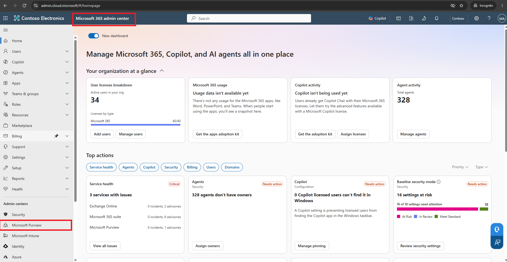
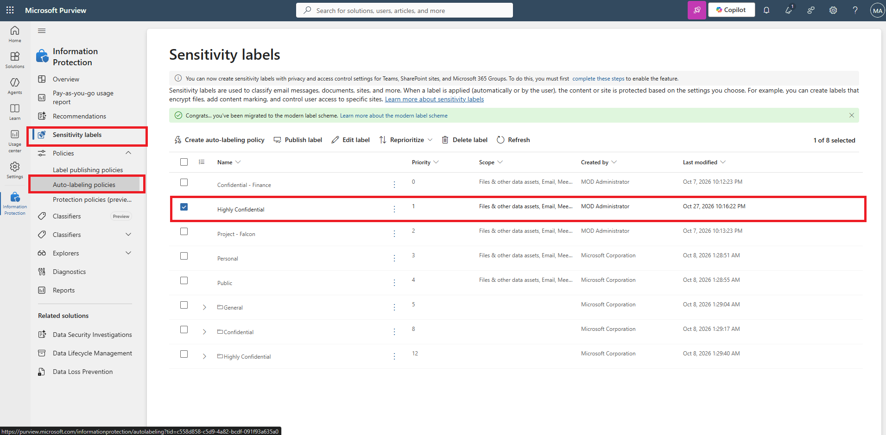
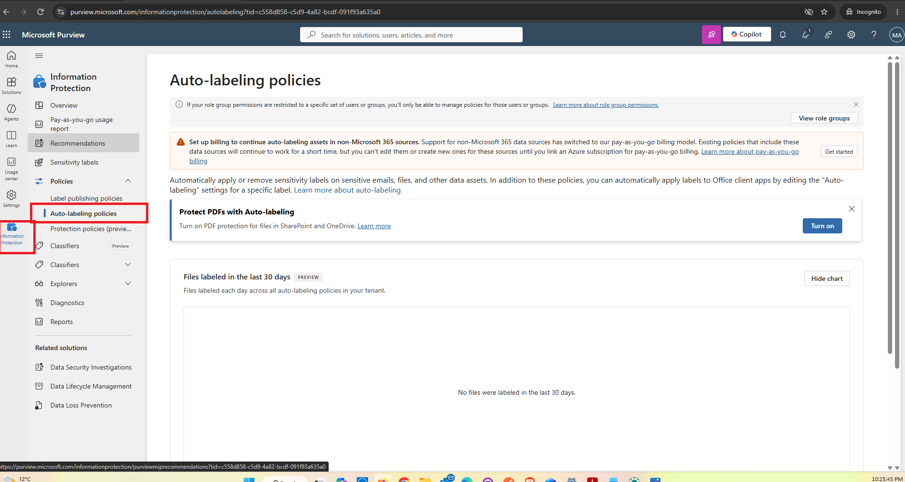
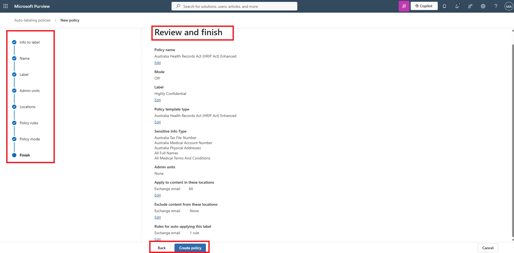

# Microsoft Purview – Sensitivity Labels & Information Protection Lab

## 1. Project Overview

This project documents my hands-on Microsoft Purview lab, completed within a Microsoft 365 environment.

The objective was to explore how organisations classify, protect, and manage sensitive information using Microsoft Purview Information Protection.

Throughout this lab, I investigated sensitivity labels, access controls, content marking, label publishing policies, and automatic sensitive-information detection.

**Technologies Used:**
- Microsoft Purview
- Microsoft 365 Admin Center
- Microsoft Information Protection
- Microsoft Entra ID
- Exchange Online
- Sensitivity Labels
- Data Classification
- Information Governance

---

## 2. Lab Implementation & Screenshot Evidence

### Step 1 – Explore Microsoft Purview Information Protection

**What I did:**

1. Signed in to the Microsoft 365 Admin Center.
2. Navigated to Microsoft Purview.
3. Selected `Solutions > Information Protection`.
4. Explored the Information Protection dashboard.
5. Reviewed the available data classification and protection capabilities.

**What I learned:**

Microsoft Purview provides centralised tools for managing information protection, including identifying, classifying, and protecting sensitive organisational data.

**Screenshot Evidence:**

---

### Step 2 – Examine the Highly Confidential Sensitivity Label

**What I did:**

1. Navigated to `Information Protection > Sensitivity Labels`.
2. Selected the existing `Highly Confidential` label.
3. Opened the label configuration.
4. Reviewed the label's scope and protection settings.
5. Examined how sensitivity labels classify and protect sensitive information.

**What I learned:**

Sensitivity labels enable organisations to classify information according to its sensitivity and apply appropriate protection controls.

**Screenshot Evidence:**

---

### Step 3 – Review Access Control Settings

**What I did:**

1. Opened the `Highly Confidential` label configuration.
2. Navigated to the access-control settings.
3. Examined the available permissions and protection options.
4. Reviewed how authorised users can be granted access to protected information.
5. Left the existing configuration unchanged.

**What I learned:**

Access-control settings help organisations restrict sensitive information to authorised users and support information security requirements.

**Security Concepts:**
- Access Control
- Data Confidentiality
- Least Privilege
- Information Protection

**Screenshot Evidence:**

---

### Step 4 – Examine Automatic Labeling Settings

**What I did:**

1. Opened the existing `Highly Confidential` label.
2. Navigated to the auto-labeling settings for files and emails.
3. Examined the configured sensitive-information detection conditions.
4. Reviewed the use of credit card number detection.
5. Investigated how matching content can trigger sensitivity labeling.

**What I learned:**

Microsoft Purview supports automatic classification of sensitive information based on configured detection conditions.

This helps organisations apply consistent information protection controls.

**Screenshot Evidence:**

---

### Step 5 – Review Additional Auto-labeling Settings

**What I did:**

1. Continued exploring the available auto-labeling configuration.
2. Reviewed additional sensitive-information detection settings.
3. Examined how policies use conditions to identify information requiring protection.
4. Reviewed the available configuration options without changing the existing label.

**What I learned:**

Automatic labeling can reduce reliance on manual classification and improve consistency in protecting sensitive organisational information.

**Screenshot Evidence:**

---

### Step 6 – Examine the Sensitivity Label Publishing Policy

**What I did:**

1. Navigated to `Policies > Label Publishing Policies`.
2. Selected the existing `Highly Confidential Policy`.
3. Opened the policy configuration.
4. Reviewed the sensitivity labels included in the policy.
5. Examined administrative units and user/group targeting.
6. Reviewed available default settings for documents, emails, meetings, and other supported content.
7. Cancelled the editing process without changing the policy.

**What I learned:**

Sensitivity labels and label publishing policies perform different functions.

- **Sensitivity Labels:** Define classification and protection settings.
- **Publishing Policies:** Control which labels are made available to users and groups.

**Screenshot Evidence:**

---

### Step 7 – Explore Auto-labeling Policy Configuration

**What I did:**

1. Navigated to `Information Protection > Auto-labeling Policies`.
2. Selected `Create Auto-labeling Policy`.
3. Explored the `Medical and Health` information template.
4. Reviewed the available sensitivity label selections.
5. Examined administrative scope and Exchange email locations.
6. Reviewed common rule conditions for detecting sensitive information.

**What I learned:**

Auto-labeling policies enable organisations to identify sensitive information in supported locations and apply sensitivity labels based on defined conditions.

This functionality is particularly relevant to protecting sensitive business, financial, and healthcare information.

**Screenshot Evidence:**

---

### Step 8 – Review Policy Settings and Deployment Options

**What I did:**

1. Continued through the auto-labeling policy configuration wizard.
2. Reviewed the configured locations and detection conditions.
3. Examined the available testing and deployment options.
4. Selected `Leave Policy Turned Off`.
5. Reviewed the proposed configuration.
6. Cancelled the wizard without creating or deploying the policy.

**What I learned:**

Security administrators should review and test information protection policies before enabling them to reduce unintended impacts on users and business operations.

**Screenshot Evidence:**

---

## 3. Key Cybersecurity Skills Demonstrated

Through this guided lab, I developed practical familiarity with:

- Microsoft Purview Administration
- Sensitivity Label Configuration
- Data Classification and Protection
- Access Control and Confidentiality
- Sensitive Information Detection
- Automated Labeling Concepts
- Security Policy Review
- Label Publishing and User Targeting
- Microsoft 365 Information Governance

---

## 4. Security Relevance

This lab strengthened my understanding of how organisations protect sensitive information across Microsoft 365 environments.

These concepts are relevant to:

- Cybersecurity Analyst
- SOC Analyst
- Microsoft 365 Security Analyst
- Cloud Security Analyst
- Information Protection Analyst

Understanding data classification, access controls, and information governance supports the broader goal of maintaining organisational confidentiality and reducing accidental exposure of sensitive information.

---

## 5. Lab Scope and Verification

This project was completed in a guided Microsoft 365 training environment.

Existing sensitivity labels and publishing policies were examined without modification.

The auto-labeling policy creation wizard was explored, but no new auto-labeling policy was deployed.

The screenshots provide supporting evidence of the configuration screens reviewed during the exercise.

**Note:** All screenshots should be reviewed and redacted to remove sensitive tenant information before being published.

---

## 6. Conclusion

This lab provided practical exposure to Microsoft Purview Information Protection and helped me understand how sensitivity labels, access controls, publishing policies, and automated classification contribute to enterprise data security.

It forms part of my ongoing hands-on cybersecurity learning and Microsoft Security portfolio development.
